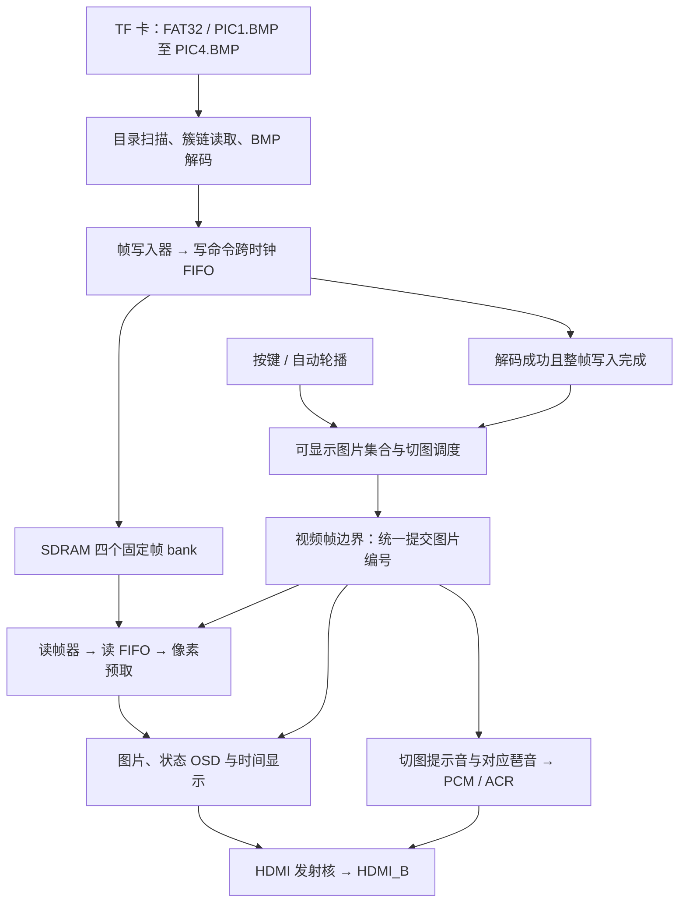

# 安路 FPGA HDMI 图片与琶音播放器

本工程将图片琶音功能与 `feat/four-buffer-preload` 的 FAT32、四 bank 预加载和 SDRAM 读写功能整合，通过 HDMI_B 同时输出 640×480 图片与 48 kHz 双声道音频。当前整合分支为 `codex/four-buffer-arpeggio`。

## 整体工作流程



上电后先扫描图片，首张图片完整写入后开始显示，并从 3 kHz 测试音切换为该图片的琶音。其余图片在后台依次预加载到各自的 bank；后台加载不会改变当前画面和旋律。已加载图片之间切换直接选择缓存，不重新读取 TF 卡。

显示有效位与 bank 编号通过握手邮箱整体跨时钟域，在视频读帧请求边界提交。读帧器、OSD 图片编号和音频事件使用同一提交结果，避免画面与旋律错配。加载失败的图片不会加入可显示集合，保留原画面与原旋律；只有一张图片或重复显示同一帧时，不重启琶音。

## 按键与声音

| 操作或状态 | 画面与声音 |
| --- | --- |
| 首图尚未显示 | 图片区域为黑色，播放 3 kHz 测试音 |
| KEY1 | 下一张已加载图片及对应琶音 |
| KEY2 短按 | 开启或关闭自动轮播，间隔约 1 s |
| KEY2 长按约 1 s | 上一张已加载图片及对应琶音 |
| 实际图片编号改变 | 先播放 1.5 kHz、100 ms 提示音，再播放六音符循环 |

每个音符持续 250 ms，一轮琶音共 1.5 s；关闭自动轮播可听完整循环。

| 逻辑图片 / bank | 六音符循环 |
| --- | --- |
| 0 | C5 → E5 → G5 → C6 → G5 → E5 |
| 1 | A4 → C5 → E5 → A5 → E5 → C5 |
| 2 | C5 → D5 → E5 → G5 → A5 → C6 |
| 3 | C5 → G4 → E5 → C5 → G4 → E5 |

有效图片按 `PIC1` 至 `PIC4` 的顺序紧凑编号。例如卡内只有 `PIC2.BMP`，它对应逻辑图片 0、bank 0 和第 0 组琶音。每个 bank 占用 307200 个 32 位字，保存 `{R,G,B,8'h00}`。

## 准备与使用

1. TF 卡使用 FAT32，图片放在根目录，命名为 `PIC1.BMP` 至 `PIC4.BMP`，使用大写 8.3 短文件名。
2. 图片须为 640×480、24 位、无压缩 BMP。可用 [图片转换与同步工具](doc/convert/README.md) 准备；同步脚本会清理卡内旧文件，使用前查看说明。
3. 用 Anlogic TD 打开 [工程文件](src/td_project/lab_ex5_i2s_v1.0.al)，构建后选择整合位流下载到开发板。
4. HDMI_B 接支持 HDMI 音频的显示器、电视或音频接收设备，并开启接收端音量。

FAT32 扫描器只扫描根目录第一个簇，不支持子目录和长文件名，图片目录项须在该范围内；图片数据本身支持非连续 FAT 簇链。一次加载最多等待 5 s，失败后停止继续预加载。

顶层 `AUDIO_TEST_ONLY=0` 为图片琶音模式，设为 `1` 后重新构建可持续输出测试音；`AUDIO_VOLUME` 默认为 `192`，增益为参数值 / 256，设为 `0` 静音。音频复用 25 MHz 像素时钟，无额外音频 PLL，左右声道相同。

## 模块分工

所有 HDL 路径均相对 `src/user_source/hdl_source/`。

| 部分 | 主要文件及职责 |
| --- | --- |
| 系统连接 | `top_tf_hdmi_audio.v`：时钟、复位、读写仲裁、视频与音频接线 |
| 文件读取 | `SD/fat32_volume_scanner.v`、`fat32_file_streamer.v`、`bmp24_decoder.v`：目录、簇链与 BMP 解码 |
| 预加载调度 | `SD/sd_card_bmp_fat32.v`：四 bank 加载、完成判定、按键与自动轮播 |
| SDRAM 写入 | `SD/media_frame_loader.v`、`media_sdram_write_cdc.v`：像素地址、上下翻转、写命令 FIFO 与突发 |
| SDRAM 读取 | `SD/media_frame_reader.v`、`fifo_prefetch_2.v`：选定 bank 回读、跨域 FIFO 与像素预取 |
| 音画同步 | `SD/media_display_commit.v`：在帧边界提交实际显示编号与音频切换事件 |
| 音频生成 | `audio/pcm_test_tone.v`、`pcm_media_tone.v`、`media_hdmi_audio_bridge.v`：测试音、琶音、48 kHz PCM 与 ACR |
| 状态显示 | `SD/status_osd_overlay.v`、`timestamp_osd.v`、`uart/uart_debug_logger.v`：OSD、时间与串口日志 |

UART 为 115200 baud、8-N-1，RX 为 F12，TX 为 D12。详细接口、音频参数与调试说明见 [代码说明](代码说明.md)。

## 验证与构建

在仓库根目录运行；TD 路径按本机安装位置调整：

```powershell
./tests/run_audio_tests.ps1
./tests/run_integration_tests.ps1
& 'F:/FPGA_anlu/TD5.6.2/bin/td_commands_prompt.exe' tests/build_audio_bitstream.tcl
```

两个仿真脚本支持 `-IverilogBin` 指定工具目录。构建输出为 `tests/build/four_buffer_audio_release/hdmi_four_buffer_audio.bit`，报告在同一目录。编译产物不提交 Git，需要本地生成。

整合版本已通过四组自检，覆盖音符和采样时序、四 bank 预加载与音画切换，以及四 bank 数据写入/回读、上下翻转和反压。存储测试使用行为级 SDRAM 与小帧，调度测试模拟图片源事务，不替代真实 TF 卡、全分辨率带宽和上板测试。

2026-10-11 的整合构建已完成 TD 综合、布局布线及位流生成，但时序尚未收敛：setup 最差裕量 −6.565 ns，hold 最差裕量 −1.540 ns。后续提交 `20442e1` 保存了 TD 工程格式及 SD 高速分频默认值修改，未重新完整构建；既有报告不代表这些修改已经重新验证。硬件播放稳定性和实际 HDMI 声音仍待上板验证。
